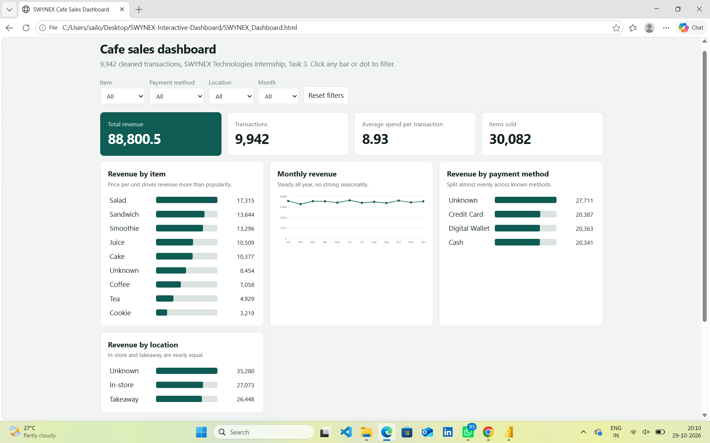

# SWYNEX Interactive Dashboard

## Project Overview
This is Task 3 of my SWYNEX Technologies internship. I built an interactive dashboard from the cleaned Cafe Sales dataset (Tasks 1 and 2). It has KPI cards, charts, and filters, and it communicates the main findings of the analysis.

## Dashboard Preview

### Overview

### With a filter applied

## Features
- **4 KPIs:** Total revenue, Transactions, Average spend per transaction, Items sold
- **4 charts:** Revenue by item, Monthly revenue trend, Revenue by payment method, Revenue by location
- **Filters:** Item, Payment method, Location, and Month dropdowns, plus a Reset button
- **Cross-filtering:** clicking any bar or dot in a chart filters the whole dashboard, and the KPIs and charts update together

## Key Findings
1. Salad earns the most revenue (17,315, about 19.5% of the total).
2. Coffee sells the most units (3,529) but earns only 7,058 because it costs 2 per item.
3. Monthly revenue stays between 6,626 (February) and 7,350 (June), so there is no strong seasonality.
4. The average order is 8.93, and the largest order (25) is valid.
5. Digital Wallet, Credit Card and Cash each cover about a third of known payments, and Takeaway and In-store are nearly equal.

## Files in this Repository
| File | Description |
|------|-------------|
| `SWYNEX_Dashboard.html` | The interactive dashboard (works offline in any browser) |
| `cleaned_data.csv` | Cleaned dataset from Task 1 |
| `dashboard_overview.png` | Screenshot of the full dashboard |
| `dashboard_filtered.png` | Screenshot with a filter applied |

## How to Open the Dashboard
1. Download `SWYNEX_Dashboard.html`
2. Double-click it to open it in Chrome, Edge or Firefox. No installation is needed.

## Data Notes
- Total revenue is 88,800.5 across 9,942 transactions.
- "Unknown" marks values that could not be recovered during cleaning in Task 1.
- 457 transactions have no date, so they are left out of the monthly chart.

## Tools Used
Python (pandas) for data preparation, and HTML, CSS and JavaScript for the dashboard.
